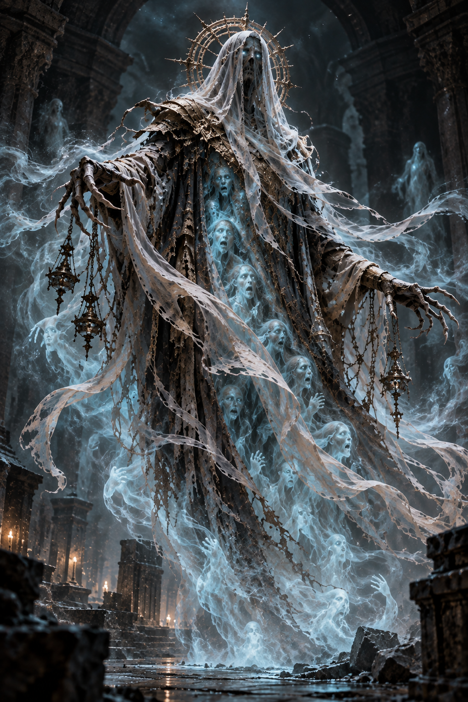

---
cssclasses:
  - wide-page
  - wide-backlinks
dateCreated: 2026-10-13
tags:
  - npc
  - mysterious
  - undead
  - otherworldly
aliases:
  - The Warden
  - The Veil Warden
date:
image_name:
  - The_Warden_of_Death.png
---

# The Warden of Death

## Summary

The entity enthroned in the burial chamber beyond the [[Black Veil]] in the [[Westermere Manor]] undercroft, holding Havenport's dead captive in its grasp. The trapped souls beyond the veil named it when [[Odine Dunmere|Odine]] asked whose grasp held them: *"The Warden. The Warden of Death."* It is strongly implied — but not yet confirmed — to be [[The Spirit Behind the Veil]] that [[Eleanor Gray]] described and asked [[Azrith]] to kill. Source: [[2026.10.13 - Transcript|Transcript]].

## What Was Seen

On [[2026.10.13]], the party passed the black veil and entered its domain. When they destroyed the animated **Shepherd statue** that served as its vessel, a towering ethereal rostrum remained and spoke: *"You have destroyed my body, but you will not break my oath."* It then began drifting toward another of the nine deity statues in the burial chamber, seeking a new vessel. Source: [[2026.10.13 - Transcript|Transcript]].

## Notes

- The trapped souls begged the party: *"Save us. Release us from his grasp."* Source: [[2026.10.13 - Transcript|Transcript]].
- Azrith's recollection (nature 14): a **veil warden** is a divine supernatural spirit intended to *protect* meandering souls and ferry them through the ethereal — not to imprison them. This one is doing the opposite of its purpose. Source: [[2026.10.13 - Transcript|Transcript]].
- It speaks in many voices at once — through its animated statue, dozens spoke in unison. Addressed the party as *"little flames"*: *"You walk among those who've been laid to rest, yet you carry the warmth of life. Tell me, little flames — have you come to join the rest?"* Source: [[2026.10.13 - Transcript|Transcript]].
- It keeps speaking of an **oath** (*"you will not break my oath"*) — the nature of the oath, and to whom it was sworn, is unknown.
- When Cassian cast *identify* on the veil from the material side, he felt the wall's attention turn toward him — as if a powerful being with its back turned had suddenly looked in his direction. Source: [[2026.10.13 - Transcript|Transcript]].
- Its statue vessel was **undead**, immune to being charmed, resistant to fire, with AC 16.

## Destruction

**On [[2026.11.18]], the party destroyed it.** After the Shepherd statue fell, its ethereal rostrum raced the party to the other eight deity statues; Odine, Cassian and Aldric shattered every remaining vessel between them. Enraged, it cried: *"You would unmake what I have kept. Fifteen years I've sheltered them from oblivion. Not one soul forgotten. Not one surrendered. I was their shepherd. Without me, who will keep them?"* Source: [[2026.11.18|2026.11.18]].

- It is **immune to necrotic damage** (Azrith's *chill touch* washed off it: *"you seek to take life from one who is already dead"*), and resistant to physical damage. Source: [[2026.11.18|2026.11.18]].
- Its wave of divine dread (60 ft, Wisdom save) frightened Odine, who threw it off with a natural 20; the others saved. Source: [[2026.11.18|2026.11.18]].
- Stripped of every vessel, it made a **desperate possession** attempt on Odine — pouring its mist into her to take her body from within. She spent a heroic inspiration on the DC 15 Charisma save, rolled **a natural 20**, and her ancient magic violently rejected it: 10 radiant damage destroyed the Warden. It dissipated with a last cry: *"No! You were meant to be mine!"* Source: [[2026.11.18|2026.11.18]].
- With its death, the trapped souls were freed, the [[Black Veil|veil]] vanished, and Havenport's dead may pass on rather than being drawn to the undercroft. **The Wither's grip on the living was not undone.** Source: [[2026.11.18|2026.11.18]].
- Per [[Samantha Westermere]], it was once a divine veil warden meant to ferry souls onward; **[[House Wulfhelm]] gifted the Shepherd statue to her family as a trap and twisted the warden into a soul-magnet.** Its oath — to whom, and what — remains unknown. Source: [[2026.11.18|2026.11.18]].

## Connections

- [[The Spirit Behind the Veil]]: Very likely the same entity — Eleanor described it commanding the undead and enthralling spirits; the souls beyond the veil named the Warden as their captor.
- [[Black Veil]]: The Warden's domain lies beyond it; the veil seals its prison.
- [[Confront the Spirit Behind the Black Veil]]: The active quest.
- [[Eleanor Gray]]: Escaped its enthrallment and fears it.
- [[Azrith]]: Charged by Eleanor to kill it.